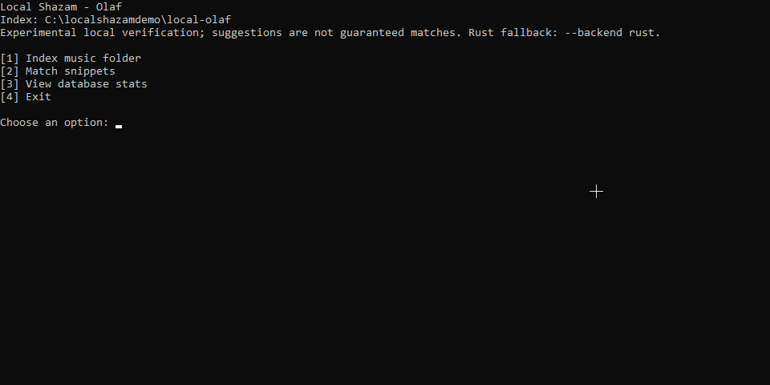

<picture>
  <source media="(prefers-color-scheme: dark)" srcset="assets/brand/mark-white.svg">
  
</picture>

<h1>Local Shazam</h1>

<strong>Find the song on your PC from a short audio clip.</strong>

Local audio recognition. No uploads. No Shazam API.

  <a href="#download">Download</a> &middot;
  <a href="#getting-started">Get started</a> &middot;
  <a href="#good-to-know">Good to know</a> &middot;
  <a href="#documentation">Documentation</a>

Got thousands of music files scattered across folders and a short clip you
recognize? Index your music folders, choose the clip as a local audio file, and
Local Shazam looks for matching audio in your collection.

You don't need the full song: a seven-second clip, for example, can be enough
to find the full track if it's in your indexed folders. When there isn't a clear
match, the app can show possible matches for you to check. Your audio stays on
your computer.

## Download

Downloads aren't public yet. We're preparing the next release.
You can [build from source](docs/BUILDING.md) in the meantime.

## Getting started

1. Install **FFmpeg and FFprobe** and make sure they're on your `PATH`.
2. Extract the app and keep the included `olaf-runtime` folder beside it.
3. Open **Local Shazam**.
4. Choose **Add a music folder** and let it index your collection.
5. Choose **Identify audio clips**, select a local audio file, and review the matches.

You can choose how many files to index at once. Start with a few workers if you
want to keep using your computer while it runs. No Python required.

## Good to know

- Searches **your library**, not an online music catalog. No uploads or Shazam API.
- Shows up to **three possible matches**. Listen and check when a result is uncertain.
- Clips can be shorter than 30 seconds; there is **no 30-second requirement**.
  For longer files, only the first 30 seconds are searched against the full indexed tracks.
- Very short, noisy or heavily edited clips can be harder to recognize.
- Looks for matching audio, not similar-sounding songs. Different versions may not match.
- Keep the original music files available after indexing.

## Documentation

- [Commands and settings](rust-app/README.md)
- [How matching works](rust-app/OLAF.md)
- [Build from source](docs/BUILDING.md)
- [Release status](docs/PREVIEW_STATUS.md) and [changelog](CHANGELOG.md)
- [Legacy Python version](legacy/python/README.md)

## Found a problem?

[Open an issue](https://github.com/imafreakandyalldontknowit67/local-shazam/issues/new)
with your app version, operating system and what happened. Remove personal paths
from logs, and don't upload your music or library database.

## License

The app's original code is [MIT licensed](LICENSE). The included Olaf runtime is
**AGPL-3.0-or-later**. See [third-party notices](THIRD_PARTY_NOTICES.md) for details.
