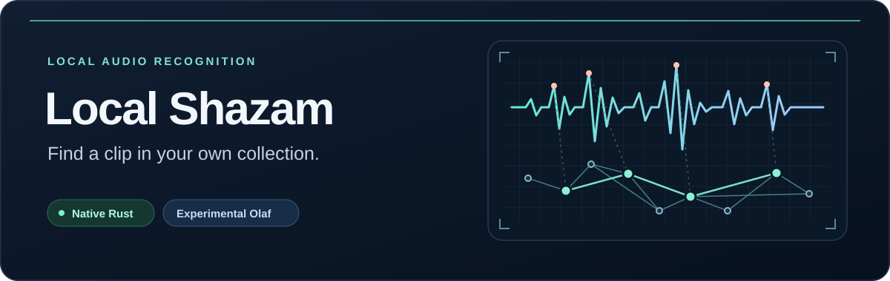

# Local Shazam

**Find the source of a clip in your own music collection.** Local Shazam indexes
the audio you choose and compares snippets locally. It does not query the Shazam
service or a global catalog, and the application does not upload your audio.

- **Native app, no Python runtime:** a Rust executable with a four-option menu,
  file/folder pickers and a CLI.
- **Complete-track indexing:** recognition is not limited to a song's opening
  two minutes. You explicitly choose what to index.
- **Evidence, not certainty:** experimental Olaf retrieval followed by local
  Rust candidate-window verification; the Rust-only comparison backend remains.

> **Private native preview.** Windows x64, Linux x64, Apple Silicon and Intel Mac
> packages passed the [native CI gates](https://github.com/imafreakandyalldontknowit67/local-shazam/actions/runs/41023384988).
> Review the [draft release and downloads](https://github.com/imafreakandyalldontknowit67/local-shazam/releases).
> Native source version: `0.2.0`; older `1.0.x` tags are Python releases.
> Packages are unsigned; distribution/license review remains open before public release.

## Get ready

The default workflow needs the app, its matching Olaf runtime, and **FFmpeg and
FFprobe installed separately on `PATH`**. Native users need no Python. Codecs
depend on the FFmpeg build; SQLite is bundled for the Rust backend.

The package layout keeps the runtime beside the app:

```text
local-shazam.exe                 # local-shazam on Linux/macOS
olaf-runtime/
  olaf.exe                      # olaf on Linux/macOS
```

For setup and packaging, see [Building](docs/BUILDING.md),
[Releasing](docs/RELEASING.md) and [Third-party notices](THIRD_PARTY_NOTICES.md).
The preview packages are verified at source commit `92a983a57ff9`; this is build
and packaging evidence, not a new snippet-accuracy or hardware-stability claim.

## Choose a folder, then a clip

Run the prepared executable without arguments for the menu:

1. **Index music folder** — choose a folder, then a worker count.
2. **Match snippets** — choose one or more existing audio files.
3. **View database stats** — inspect the selected backend's index.
4. **Exit**.

Opening the menu does not start indexing. Choose a small folder and a new,
writable index location outside your source audio. Default workers are available
parallelism capped at **six**, or four if detection fails. More workers are not
necessarily faster or safer.

PowerShell examples; replace these paths with your own. `bootstrap` writes the
index, not your music files:

```powershell
.\local-shazam.exe --olaf-index "D:\AudioIndexes\trial-olaf" bootstrap "D:\Music\SmallFolder" --workers 2
.\local-shazam.exe --olaf-index "D:\AudioIndexes\trial-olaf" match "D:\Clips\snippet.mp3"
.\local-shazam.exe --olaf-index "D:\AudioIndexes\trial-olaf" --json status
```

Use `./local-shazam` and your own POSIX paths on a prepared Linux/macOS target.
See the [native command guide](rust-app/README.md) for the comparison backend.

## How recognition works

**Index → retrieve with Olaf → verify source windows with Rust → review.**
Original files must remain available for local candidate verification.

Olaf is the **experimental default**. It shortlists up to ten files; Rust checks
alignment and independent supporting moments before showing up to three
suggestions. Only the **first 30 seconds of an Olaf query** are analyzed; indexed
tracks are processed in full, so queries can originate later in a track.

| Olaf result | What it means |
| --- | --- |
| `strong_match` | Stronger heuristic evidence and a lead over other verified candidates; not a guarantee. |
| `possible_matches` | Up to three files meet minimum evidence requirements; review them yourself. |
| `insufficient_evidence` | No candidate passes; a clearer or more distinctive clip may help. |

These labels and the Rust backend's percentage-like scores are **not calibrated
probabilities**. See [Olaf behavior and limits](rust-app/OLAF.md).

### Separate backends, separate indexes

| Backend | Selection | Default storage beside the executable |
| --- | --- | --- |
| Olaf + Rust verification | Default, or `--backend olaf` | `local-olaf/`; override with `--olaf-index DIRECTORY` |
| Rust comparison engine | `--backend rust` | `local-shazam.db`; override with `--db FILE` |

There is **no automatic index conversion** between Python, Rust and Olaf. Index
selected folders separately. `--db` requires `--backend rust`.

## Limits to understand

- Held-out accuracy and Rust-equivalent accuracy for the integrated pipeline
  are unverified. Short/noisy clips, quiet sections, pitch/speed edits, covers
  and live performances can fail or yield ambiguous suggestions.
- No automatic recording-family grouping, quality-version selection or playback
  controls. Different encodes, mixes and masters may appear separately.
- No Olaf `remove` or `compact-db`. Rust maintenance affects only Rust indexes;
  Olaf runtime/config changes can require a fresh index.
- Olaf scans recognized extensions; unlike Rust, it does not probe unfamiliar
  extensions. DRM, malformed files and unavailable codecs may prevent decoding.
- Metadata/leading-file identity checks can miss edits; forced reindexing may
  be needed. Missing or changed sources can prevent verification.
- Large libraries and long tracks can consume substantial CPU, memory, disk and
  temporary space despite bounded queues. Development crashes have an unresolved
  cause and post-crash index integrity is unverified. The six-worker default cap
  is **not a stability fix**; do not resume work on a machine with unresolved crashes.

## Legacy Python reference

`shazam/`, `start.py` and `pyproject.toml` retain the unchanged Python `1.0.1`
reference, requiring Python 3.10+ and its dependencies. It is not the native
release path: its first-120-second decoding, 30-second decode timeout and
size/first-8-KiB identity checks still apply, unlike complete-track native indexing.

## Project notes and licensing

[Changelog](CHANGELOG.md) · [Native guide](rust-app/README.md) ·
[Olaf design](rust-app/OLAF.md) · [Proposed repository metadata](docs/REPOSITORY_METADATA.md)

Original application code: [MIT](LICENSE). The separately shipped, modified Olaf
runtime is **AGPL-3.0-or-later**, not MIT. See
[Third-party notices](THIRD_PARTY_NOTICES.md); packages must retain matching Olaf
source, patches and required notices. MIT is not a blanket label for the package.
