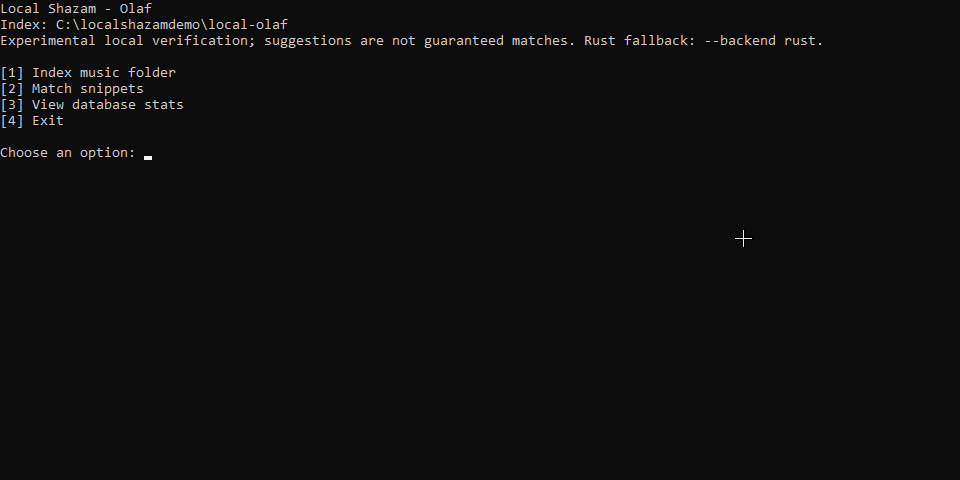

# Local Shazam: Windows quickstart

Local Shazam searches only music you explicitly index on your computer. It
does not upload audio, search an internet catalog, or use the Shazam API.
Opening the app does **not** automatically index your music.

## Current release: recorded private v0.2.1

The existing [release record](PREVIEW_STATUS.md) identifies **v0.2.1 as Latest
inside the PRIVATE repository**, built at
`d32716df0be1a5ea2d919d0b8ceb560de17bd77c`. This restates recorded evidence,
not newly checked remote state; later documentation commits do not change the
binaries. Downloads require repository access. Only Windows x64+x86 are included;
older v0.2.0/native-preview and Linux/macOS records are
[historical](RELEASING.md), not current v0.2.1 platform releases.

x64 execution was tested natively; x86 was tested under **WOW64 on x64 Windows**,
not on a native 32-bit Windows OS. Clean-host installation, a supported minimum
Windows version, signing, audio accuracy and hardware stability are not
established. Historical privacy review, legal review and public-release approval
remain open. No application or audio checks were rerun for this guide update.

## 1. Prepare the app

- Install **both FFmpeg and FFprobe** separately from Local Shazam and make
  both available on Windows **PATH**. PATH is the list of folders Windows
  checks when an app needs to find a tool; include the folder containing these
  tools. Use builds compatible with your Windows OS; a 32-bit OS needs compatible
  32-bit tools. Neither tool is bundled. Python, Rust, Zig and developer build
  tools are **not required to use the packaged app**.
- Check the [root README](../README.md) for current download availability.
  Choose **`Local-Shazam_0.2.1_x64.zip`** for Intel/AMD 64-bit Windows, or
  **`Local-Shazam_0.2.1_x86.zip`** for the 32-bit app/runtime, subject to the
  unverified native 32-bit OS compatibility noted above.
  Use x64 for large libraries: x86 has a **512 MiB database mapping limit**,
  not a 512 MiB total-RAM guarantee. Decoding and workers need additional memory.
  Extract the **complete ZIP** to a folder
  you can write to. Preserve all its contents, including notices, and keep
  `olaf-runtime` beside `local-shazam.exe`. Do not run from inside the ZIP.
- Install applicable Microsoft runtime components from **official Microsoft
  installers or Windows servicing**, not copied DLLs or third-party DLL sites.
  The recorded app imports include `vcruntime140.dll`; both executables also
  require Universal CRT/Windows components. Runtime architecture must match the
  app: x64 for x64, **x86 for x86 even on x64 Windows under WOW64**. See
  [Microsoft's redistribution guidance](https://learn.microsoft.com/en-us/cpp/windows/redistributing-visual-cpp-files?view=msvc-170)
  and the [recorded dependency limits](BUILDING.md). This is prerequisite guidance,
  not a claim that a clean PC has been tested.
- These packages are unsigned, and Windows may show security warnings. Check
  the download's source and release information; if unsure, stop rather than
  bypass protections or dismiss warnings blindly.

Matching source downloads are `Local-Shazam_0.2.1_x64_app-source.tar.gz`,
`Local-Shazam_0.2.1_x64_olaf-source.tar.gz`,
`Local-Shazam_0.2.1_x86_app-source.tar.gz` and
`Local-Shazam_0.2.1_x86_olaf-source.tar.gz`. Together with the two ZIPs and combined
`SHA256SUMS.txt`, these are **seven release assets**. You do not need to build
the sources to run the app; preserve matching sources/notices when redistributing.
The records report actual download-byte comparisons for all seven assets and
archive verification per target, not new checks by this guide. Checksums show
consistency, not publisher authentication. Maintainer verification uses
[separate per-target directories](BUILDING.md), not all seven files at once.

## 2. Open the console menu

Run `local-shazam.exe` from the extracted folder. In the console window,
type a menu number and press **Enter**. Windows folder and file selection
dialogs open when needed.

The plain **Local Shazam** heading appears above **[1] Add a music folder**,
**[2] Identify audio clips**, **[3] View library stats**, and **[4] Exit**.
Startup no longer prints the backend, index path or development banner. Type
**4** and press Enter to exit. Later operations can still display file paths.

## 3. Add your music first

Type **1**, then press Enter for **[1] Add a music folder**. In the folder
dialog, select a folder containing complete tracks; start with a small folder.

At the **Worker count** prompt, explicitly type **2** and press Enter. This
means two indexing workers, **not menu option 2**. It is a conservative starting
choice, not a guarantee of safety or stability. Do not resume indexing on a
computer with unresolved crashes.
Pressing Enter without a number selects the automatic default (at most six),
not necessarily two. Larger selections are not established safe, and lowering
the count is not a proven fix for unresolved crashes or post-crash index damage.

Wait for indexing to finish and inspect any reported failures before trying
to identify a clip.

## 4. Identify a local clip

Back at the menu, type **2** and press Enter for **[2] Identify audio clips**.
Use the file dialog to select an existing **local audio file**.

A seven-second snippet is one example, not a promise of recognition.
**30 seconds is the maximum analyzed query duration, not a minimum.** Shorter
clips are allowed; longer files use only their first 30 seconds. The complete
tracks you indexed are processed in full.

Review up to **three suggestions**; there may be fewer or none. Results and
their labels reflect supporting audio evidence, not certainty or a measured
chance of being correct. Listen to the original files in your own audio player
to check suggestions. The app looks for matching audio, not similar-song
recommendations.

## 5. Check and keep your library

Type **3** and press Enter for **[3] View library stats** to see the indexed
song count and storage information.

Keep original music files available at their indexed paths, and retain the
default `local-olaf` index folder beside the executable. Moving, deleting, or
changing source files can prevent verification. **The index does not replace
your music.** When changing between x86 and x64, use a new index folder and
index the music again; do not copy the old index across architectures.
Do not replace runtime files inside an existing index to switch architectures.

## Troubleshooting

- **Missing FFmpeg or FFprobe:** install both, correct Windows PATH, then
  reopen the app.
- **Missing Olaf runtime:** restore the complete matching package, keeping
  `olaf-runtime` beside `local-shazam.exe`.
- **Missing Microsoft runtime DLL:** use the architecture-appropriate official
  installer/Windows servicing route above; do not download individual DLLs.
- **No match:** confirm indexing finished and the originals remain available
  at their indexed paths. Try a clearer or longer local snippet with useful
  audio within its first 30 seconds. No result does not prove the song is absent.

For optional CLI commands and settings, see the
[native application guide](../rust-app/README.md). For technical matching
details, see [how matching works](../rust-app/OLAF.md).
